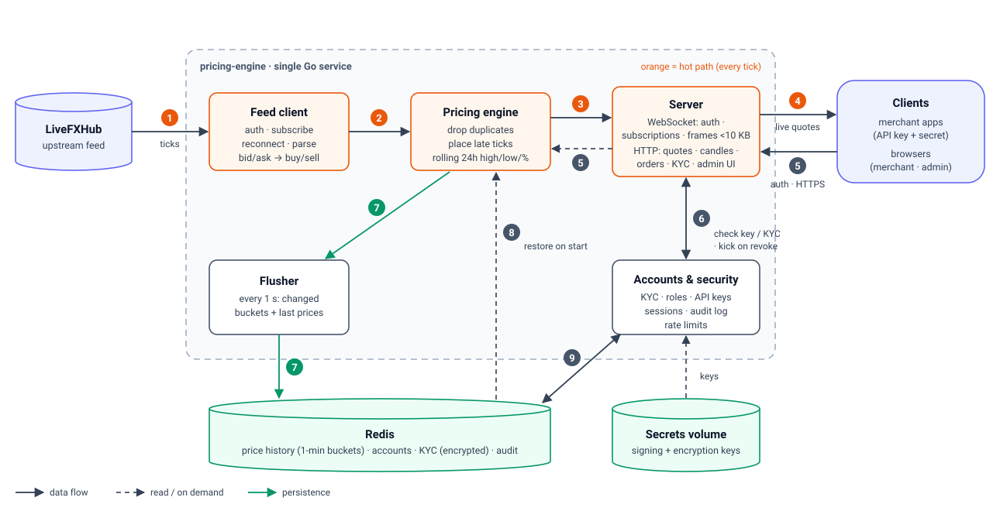

# Real-Time Pricing Engine (Go)

A low-latency, fault-tolerant market-data service written in Go. It does
four things:

1. Consumes the LiveFXHub WebSocket feed and subscribes to 61 symbols.
2. Computes **buy, sell, rolling 24h high, 24h low and 24h % change** itself.
   The upstream `low_24h`, `high_24h` and `change_24h` fields are never
   decoded.
3. Persists state to Redis and restores it after a restart.
4. Fans compact updates (always **< 10 KB** per frame) out to any number of
   WebSocket clients.
5. Lets **only KYC-verified merchants** trade or subscribe. Merchants
   register, submit KYC, are approved by an admin, and receive an API key for
   the WebSocket feed. There's a web UI for merchants and admins.

Measured results (details in [Performance](#performance)):
- **Live feed:** engine receive → client receive p99 **6 ms**; the engine's
  own processing p99 is **≤ 0.5 ms**.
- **Simulator, 500 concurrent clients:** end-to-end p99 **12 ms** against a
  50 ms target; ~257 KB frames in, ~4 KB frames out.

| Doc | Contents |
|---|---|
| [docs/ARCHITECTURE.md](docs/ARCHITECTURE.md) | Architecture diagram, numbered data flow, tick sequence, components, goroutines, storage layout, scaling |
| [docs/SECURITY.md](docs/SECURITY.md) | Written answer to the KYC & Authentication scenario, with Go middleware |
| [docs/CHALLENGES.md](docs/CHALLENGES.md) | Problems faced and how they were solved, in narrative form |
| [docs/24H-STATS.md](docs/24H-STATS.md) | How 24h high, low and % change are computed, with a worked example |



---

## Quick start

**Prerequisites:**
- Docker Desktop (or Docker Engine with Compose v2);
- for running locally or running tests: Go 1.25.

Port 8080 must be free.

```bash
docker-compose up --build
```

No configuration is needed. Without a `.env` file, the engine connects to the
bundled **simulator**, which speaks the same auth/subscribe protocol. The
simulator sends ~256 KB frames and injects duplicates, out-of-order ticks and
bogus upstream 24h values.

**To use the live feed:**

```bash
cp .env.example .env      # set API_KEY / API_SECRET (shared via your registered email)
docker-compose up --build
```

`.env` sets `UPSTREAM_URL=wss://v3-prod.livefxhub.com/ws/algo`. The engine
then performs the expected workflow:
1. connect;
2. send `{"action":"auth",...}`;
3. wait for a non-error reply;
4. send `{"action":"subscribeMarketPrice","symbols":[...61...]}`;
5. log `receiving live market prices` on the first price frame.

**Try it:** price data is for **verified merchants only**, so walk through
the flow once.

1. **Admin password.** On first start the engine creates `admin@example.com`.
   If `ADMIN_PASSWORD` isn't set in `.env`, it prints a random password once:
   `docker compose logs pricing-engine | Select-String -Context 0,3 BOOTSTRAP`.
2. **Register a merchant** at http://localhost:8080/login. The new account is
   an *unverified merchant*: it can log in, but quotes, API keys and orders all
   answer 403.
3. **Submit KYC** on **My account**: legal name, date of birth, country,
   document type and number, plus an optional JPEG, PNG or PDF scan.
4. **Approve it as admin** at http://localhost:8080/admin: Review → Approve.
   The admin page shows each merchant's role, KYC status, API key, live
   sessions with their subscribed symbols, and the audit log.
5. **Back as the merchant**, on **My account**: generate an API key (the
   secret is shown once), then open **Live quotes**. Click a row for candles:
   - the current candle updates on every tick;
   - pick a window: 30m / 1h / 3h / 6h / 12h / 24h, with longer windows
     merging into 5m–30m candles;
   - periods with no data, such as an upstream outage, show as shaded
     "no data" bands on a real time axis.

```bash
curl localhost:8080/healthz                                    # public
curl localhost:8080/metrics                                    # public (Prometheus)
curl -H "X-API-Key: pk_..." -H "X-API-Secret: sk_..." "localhost:8080/api/v1/quotes?symbols=EURUSD,BTCUSD"
curl -H "X-API-Key: pk_..." -H "X-API-Secret: sk_..." "localhost:8080/api/v1/candles?symbol=XAUUSD&limit=5"
```

Security design, flow diagram and every check: **[docs/SECURITY.md](docs/SECURITY.md)**.

**Run locally without Docker** (needs Go 1.25 and a Redis):

```bash
go run ./cmd/simulator &
API_KEY=demo-key API_SECRET=demo-secret UPSTREAM_URL=ws://localhost:9001/ws/algo go run ./cmd/pricing-engine
```

Keys are created in `./.secrets` on first run; the folder is git-ignored.

### Operations

| Task | Command |
|---|---|
| Follow logs | `docker compose logs -f pricing-engine` |
| Health / metrics | `curl localhost:8080/healthz`, `curl localhost:8080/metrics` |
| Dashboards | Grafana http://localhost:3000 · Prometheus http://localhost:9090 |
| Stop (keep data) | `docker compose down` |
| **Reset everything** (price history, accounts, keys) | `docker compose down -v` |
| Back up data | Stop the stack, then archive both volumes: `docker run --rm -v pricing-engine_redis-data:/data:ro -v ${PWD}:/backup alpine:3.20 tar czf /backup/redis-data.tgz -C /data .` (same for `pricing-engine_secrets-data`) |
| Restore data | Create the volume, then extract: `docker run --rm -v pricing-engine_redis-data:/data -v ${PWD}:/backup:ro alpine:3.20 tar xzpf /backup/redis-data.tgz -C /data` |

The compose project name is fixed (`name: pricing-engine`), so the volume
names don't depend on the folder you run from.

The two volumes together can decrypt every merchant's KYC data, so treat
backups as sensitive. Never share `.env`: it holds the upstream API key.

## Downstream protocol

Connect to `ws://host:8080/ws`. It mirrors the upstream protocol: authenticate
first, then subscribe. Optional query parameters:
- `format=binary`
- `symbols=EURUSD,GBPUSD` (or `*`) to subscribe as soon as authentication
  succeeds.

| Client → server | Meaning |
|---|---|
| `{"action":"auth","api_key":"pk_…","secret":"sk_…"}` | **Required first**, within 10 s. Server replies `{"t":"authenticated"}`. Bad credentials → close **4001**; valid key but KYC not approved (or account disabled) → close **4003**; more than 5 sessions per key → **4008**. |
| `{"action":"subscribe","symbols":["EURUSD","GBPUSD"]}` | Add symbols (`["*"]` = all). The server replies `subscribed`, then a snapshot of current quotes. |
| `{"action":"unsubscribe","symbols":["GBPUSD"]}` | Remove symbols (`["*"]` = all). |
| `{"action":"ping"}` | Server replies `{"t":"pong","ts":...}`. |

Server → client messages:

```jsonc
{"t":"welcome","fields":["symbol","buy","sell","high24h","low24h","change24hPct","ts"],"symbols":[...],"format":"json"}
{"t":"q","d":[["EURUSD",1.16059,1.16048,1.162235,1.158075,-0.1463,1792133126953], ...]}   // only symbols that changed
{"t":"error","msg":"unknown symbols","symbols":["FOO"]}
```

**Binary format** (little-endian):

```
'Q' | version u8 | count u16 | count × (len u8 | symbol | buy f64 | sell f64 | high f64 | low f64 | chg f64 | ts i64)
```

- **Inbound rate limit:** clients are limited to 10 commands/s (burst 20).
  Exceeding it closes the socket with code 1008 (policy violation).
- **Slow clients:** a client that can't take a frame within 5 s is dropped.
- **Access is continuous, not only at login.** Live sockets are closed
  (4003) the moment an admin rejects, re-verifies or disables the merchant,
  or the key is rotated or revoked. Every 30 s each connected merchant is
  re-checked, which catches KYC expiry with no admin action.
- **Browser clients** never hold the API secret. The quotes page exchanges
  its HttpOnly session for a single-use, 30-second ticket
  (`POST /api/v1/ws-ticket`) and connects with `/ws?ticket=…`.

## HTTP API

Browsers authenticate with the session cookie set at login. Programs use the
`X-API-Key` / `X-API-Secret` headers on the market-data and order endpoints.
The full permission matrix is in [docs/SECURITY.md](docs/SECURITY.md).

| Endpoint | Who | Purpose |
|---|---|---|
| `GET /healthz`, `GET /metrics` | anyone | liveness and dependencies; Prometheus metrics |
| `GET /`, `/login`, `/account`, `/admin` | anyone (the page then checks login) | UI pages |
| `POST /api/v1/auth/register`, `login`, `refresh`, `logout` | anyone | session management (HttpOnly cookies) |
| `GET /api/v1/me`, `POST /api/v1/kyc` | logged-in | profile; KYC submission (multipart, document ≤ 2 MB) |
| `GET /api/v1/quotes?symbols=`, `GET /api/v1/candles?symbol=&limit=` | verified merchant or admin | current quotes; 1-minute OHLC candles |
| `POST /api/v1/ws-ticket` | verified merchant or admin | single-use ticket for the browser WebSocket |
| `POST /api/v1/apikey` | verified merchant | create or rotate an API key (secret shown once) |
| `DELETE /api/v1/apikey` | logged-in | revoke your own API key |
| `POST /api/v1/orders` | verified merchant | simulated fill at the live price |
| `GET /api/v1/admin/merchants?page=&size=&q=&status=` | admin | merchant list, paginated (default 10), with search and KYC filter |
| `GET /api/v1/admin/merchants/{id}`, `…/{id}/document` | admin | decrypted KYC details and document scan (both audit-logged) |
| `POST /api/v1/admin/merchants/{id}/kyc` | admin | `approve` (with validity days), `reject` (with reason), `reverify` |
| `POST …/{id}/disable`, `…/{id}/enable`, `DELETE …/{id}/apikey` | admin | account and key control; closes the merchant's live sessions |
| `GET /api/v1/admin/sessions`, `GET /api/v1/admin/audit?page=&size=` | admin | live WebSocket sessions; audit log, paginated |

## Design decisions & trade-offs

| Decision | Why | Trade-off |
|---|---|---|
| **1-minute bucket ring (1440 slots) per symbol** for the 24h window | O(1) work per tick; fixed ~73 KB per symbol whatever the tick rate. The minute buckets double as 1m OHLC candles. | The window edge has 1-minute granularity: a price leaves the 24h stats when its whole minute is older than 24h. A tick-exact window would need a monotonic deque over every tick, which costs more memory and makes persistence much heavier. |
| **Event-time clock** (max tick timestamp seen) | Deterministic and replayable; one bad local clock can't distort the window. | If the whole feed stops, the window stops advancing too. That's acceptable, since there is nothing new to publish. Ticks stamped more than 5 min ahead of receive time are rejected so one bad timestamp can't fast-forward the clock. |
| **Statistics on mid price** `(buy+sell)/2` | Symmetric and standard for display. Buy/sell are passed through exactly as received. | If bid-based or ask-based highs are required, it's a one-line change in `engine.midPrice`. |
| **% change vs. the open of the oldest bucket in the window** | The best observable estimate of "the price 24h ago". | Right after a cold start (empty Redis) the reference is the first price seen, so the figure covers less than 24h. This fixes itself as history builds, and state restore keeps it across restarts. |
| **Single-writer engine + RWMutex** | No lock contention on the hot path. Apply for 61 symbols takes ~14 µs. | A single core caps throughput (~70k batches/s, far above the feed). Scale-out is by sharding symbols (see ARCHITECTURE.md). |
| **Per-client conflation** (≤ 1 pending quote per symbol) | A slow client gets the latest state, not a growing backlog. Memory per client is bounded, and one client can never stall the hub. | A slow client skips intermediate prices. That's correct for a price stream, but this is not a trade-tape. |
| **Batch-then-wake** in `Hub.Publish` | A 61-symbol upstream frame leaves as one downstream frame. This change cut frames by 8× and p50 latency from 7 to 5 ms. | — |
| **Positional-array JSON rows** + optional binary | ~65 B per symbol; a full 61-symbol update is ~4 KB, so < 10 KB comes without relying on compression. | Field names travel once, in `welcome`. Binary is only ~15% smaller because it keeps f64 precision; deflate (enabled for frames > 1 KB) is the bigger lever. |
| **Redis (AOF) for state; write dirty buckets only, once per second** | Survives restarts of the process *and* of the container. Lets replicas share state. Write load is ~61 small HSETs/s, independent of tick rate. | Up to ~1 s of bucket updates can be lost on a hard crash; live ticks refill them immediately. If Redis is down, the engine keeps serving from memory and buffers unsaved changes until Redis returns. |
| **Bounded channel with blocking send** between feed and engine | Back-pressure onto TCP during spikes instead of unbounded memory growth or silently dropping ticks (which would corrupt high/low). | Under sustained overload, latency grows rather than data being lost. In practice the engine is 1000× faster than the feed. |
| **`goccy/go-json` for upstream decoding** | ~5× faster than `encoding/json` on 256 KB frames (0.22 vs 1.1 ms); same API, so the parser code is unchanged. | One extra dependency, plus a per-frame input copy (see Performance). |
| **Tolerant upstream parser** | The live format (`{"event":"marketPriceSnapshot","symbol","bid","ask",...}`, no timestamp) differs from the brief (`buy/sell/timestamp`). The parser accepts both, plus arrays, `{"data":…}` wrappers and symbol-keyed maps, with numbers or strings and timestamps in s/ms/µs/ns or RFC 3339; it uses receive time when there's no timestamp. | Slightly more code than a strict decoder. Frames that parse but contain no ticks are counted (`pe_upstream_unrecognised_frames_total`) and sampled in the logs, so a future format change is caught immediately. |
| **Hand-rolled metrics** (Prometheus text format) | Zero extra dependencies. Lock-free counters and histograms. | Fewer features than `client_golang`. |

**Accounts and access control** (details in [docs/SECURITY.md](docs/SECURITY.md)):

| Decision | Why | Trade-off |
|---|---|---|
| **Roles derived from KYC status on every request** (`verified_merchant` only while KYC is approved and unexpired) | A role can never disagree with KYC; expiry takes effect instantly, with no cron job. | One account read per request: a Redis GET, microseconds. |
| **Accounts in Redis**, already in the stack, not a new SQL database | No extra service or migrations; one dependency to run and back up. | No relational queries. The admin list loads all accounts and filters in memory, which is fine for thousands of accounts. Beyond that, move accounts to PostgreSQL (the store is one small file). |
| **API secrets stored as HMAC-SHA256 with a pepper**, not Argon2 | Secrets are 256-bit random, so a slow hash adds nothing but latency on every WebSocket login. The pepper lives outside Redis. | Losing the secrets volume invalidates all API keys (merchants re-issue them). |
| **Keys on a separate volume from the data** | A Redis dump alone can't decrypt KYC, forge sessions or test stolen API secrets. | Two volumes to back up together. |
| **Browser WebSocket uses a single-use 30 s ticket** | The API secret never sits in page JavaScript; the session cookie stays HttpOnly. | One extra request per connect. |
| **Session state (refresh tokens, revocations, tickets) in memory** | Simple and fast for a single instance. | A restart logs everyone out; multiple replicas would need this moved to Redis. |
| **Access re-checked continuously:** kick on change, plus a 30 s sweep | A downgrade, disable or KYC expiry cuts live sockets, not just new logins. | Up to 30 s before a pure expiry is noticed on an open socket (admin actions are instant). |
| **Admins get read-only market data, no trading** | Oversight without breaking separation of duties: the KYC approver can't trade. | Admins can't place orders or hold API keys; use a verified merchant for that. |
| **Server-side pagination** (page size 10) | Search and filters cover every record, not just the visible page; per-row lookups run only for the shown page. | The total is computed per request (see the Redis trade-off above). |
| **Embedded vanilla-JS UI, strict CSP** | No build step, no external assets, served by the same binary; `script-src 'self'` with no inline code. | Hand-written DOM code instead of a component framework. |

## Fault tolerance

| Failure | Behaviour | Verified by |
|---|---|---|
| Upstream disconnect / silence | The read deadline (30 s) plus ping/pong detects a dead link. The engine reconnects with exponential backoff (0.5 → 30 s) and full jitter, then re-auths and re-subscribes. | `TestClientAuthSubscribeReconnect`; the compose run with `SIM_DROP_EVERY=8s` reconnected 3× in 25 s |
| Auth rejected | Logged at ERROR with the server message; retried with backoff (credentials might be rotated). | `TestClientAuthRejected` |
| Session already active (upstream allows one session per API key) | Recognised separately from bad credentials: a WARN tells you to close the other client, and retries every 30–40 s so the server-side lock isn't kept alive. Every exit sends a WebSocket close frame, so our own restarts release the session at once. | `TestClientSessionInUse` |
| Duplicate ticks (incl. replay after reconnect) | 64-entry fingerprint ring per symbol (ts, buy, sell) → dropped and counted. | `TestDuplicatesAndOutOfOrder`; 305 dupes dropped in the compose run |
| Out-of-order ticks | Still counted in the bucket they belong to (high/low/reference stay correct), but they never overwrite the latest buy/sell. | `TestDuplicatesAndOutOfOrder`, `TestAgainstBruteForce` (5% late ticks over 2.3 simulated days) |
| Bad data | Zero, negative, NaN or Inf prices, unknown symbols, timestamps far in the future, ticks older than 24h → rejected and counted. | `TestRejectsBadTicks` |
| Traffic spikes | Bounded queues everywhere; conflation per client; downstream frames split at the size cap. | `TestSlowClientConflation`, `TestEncodeFramesRespectLimit` |
| Slow / stuck client | 5 s write deadline → disconnected; other clients unaffected. | `TestSlowClientConflation` |
| Restart (SIGTERM) | Stop the feed → drain the pipeline → final flush → exit. On boot: restore, then serve the snapshot immediately. | Compose restart: all buckets restored, candles continuous |
| Crash (SIGKILL) | Lose at most the last second of bucket updates. | `docker kill -s KILL` → 549/549 buckets restored |
| Redis outage | `/healthz` reports `degraded`; quotes keep flowing; each flush times out after 5 s; unsaved changes are kept and merged into the next flush. | `TestFlusherKeepsDataWhenStoreFails`; compose `stop redis` for 12 s → 2 flush errors, then full recovery |

## Performance

### Live feed (LiveFXHub)

Measured against the running stack with 5 authenticated `wsbench` clients
(the per-key session limit) for 20 s, plus the server's own latency
histograms over the same window.

| Measure | Result |
|---|---|
| Upstream rate / frame size | ~111 frames/s, **~128 B** per frame (one symbol each; nowhere near the brief's ~256 KB) |
| Engine processing (receive → handed to WebSocket hub), `pe_process_latency_seconds` | avg 0.19 ms · p95 ≤ 0.25 ms · **p99 ≤ 0.5 ms** |
| Receive → written to client socket, `pe_ws_send_latency_seconds` | avg 0.39 ms · p95 ≤ 0.5 ms · **p99 ≤ 2.5 ms** |
| Receive → client receive (`wsbench`, 1 ms resolution) | p50 < 1 ms · p95 1 ms · **p99 6 ms** · max 41 ms |
| Downstream frames | avg 168 B; max 3,182 B (the initial 50-symbol snapshot) |

The live feed has no timestamp, so the engine stamps each tick on receipt;
these figures therefore cover our system end to end, not the network from
LiveFXHub.

### Simulator (load and payload test)

These runs were measured before downstream authentication was added.
Authentication happens once per connection and doesn't touch the per-tick
path.

**Environment:**
- AMD Ryzen 5 5600H, 16 GB RAM, Windows 11, Docker Desktop.
- Engine, simulator, Redis and load generator all on one machine.
- Simulator sends 61 symbols every 100 ms in **~257 KB frames** (measured
  average 257,629 B).

**How e2e latency is measured:** the simulator stamps each tick with its send
time; `wsbench` subtracts it from its own receive time. The measured span
therefore covers simulator JSON encode, network, engine parse (256 KB),
compute, fan-out and client decode.

| Scenario | Frames/s | Avg / max frame | e2e p50 | p95 | p99 | max |
|---|---|---|---|---|---|---|
| 100 clients, JSON, 30 s | 1,002 | 3,977 B / 3,992 B | 5 ms | 8 ms | 11 ms | 27 ms |
| 500 clients, binary, 20 s | 4,990 | 3,359 B / 3,359 B | 6 ms | 10 ms | 12 ms | 24 ms |
| *(before batch-then-wake)* 100 clients, JSON | 7,973 | 521 B / 4,073 B | 7 ms | 12 ms | 15 ms | 21 ms |

- **Payload:** ~257 KB per upstream frame → **~4 KB per downstream frame**.
  That is a ~65× reduction before compression, and well under the 10 KB cap.
- **Latency:** p99 is 11–12 ms, well within the ≤ 50 ms target. Each tick
  reaches clients in the same 100 ms tick interval it arrived in (the
  "1 tick" criterion).

Micro-benchmarks (`go test -bench . ./internal/...`):

| Benchmark | Result |
|---|---|
| `Engine.Apply`, one 61-symbol batch | ~14 µs/op (52 µs with the Docker stack loading the CPU), 11 allocs |
| `feed.Parse`, one 256 KB frame | **~0.22 ms/op (~1.17 GB/s)** with `goccy/go-json`; was ~1.1 ms (235 MB/s) with `encoding/json` |

Parsing was the largest part of in-process latency. Switching the decoder to
`goccy/go-json`, a drop-in replacement used only in `internal/feed`, made it
~5× faster. The cost is ~278 KB of garbage per frame, because the library
copies its input; at ~10 frames/s that's about 3 MB/s, which the GC handles
easily.

**Reproduce:**

```bash
docker-compose up -d --build
docker-compose run --rm --entrypoint /usr/local/bin/wsbench pricing-engine \
  -url ws://pricing-engine:8080/ws -clients 100 -duration 30s \
  -key pk_... -secret sk_...                                             # a verified merchant's key; add -format binary
# (the per-key session limit is 5: set MAX_CONNS_PER_MERCHANT=1000 for load tests,
#  or WS_REQUIRE_AUTH=false to benchmark without auth)
curl -s localhost:8080/metrics | grep -E "pe_(process|ws_send)_latency"   # server-side histograms
```

## Tests

```bash
go test ./...                       # unit + integration (miniredis, httptest WebSockets)
go test -race ./...                 # needs cgo; or run it in Docker:
docker run --rm -v "$PWD:/src" -w /src golang:1.25 go test -race ./...
go test -run xxx -bench . -benchmem ./internal/engine ./internal/feed
```

All packages pass, including under `-race` (run in `golang:1.25`).

Highlights:
- **`TestAgainstBruteForce`** checks the bucketed window against a naive
  full recomputation: 20,000 random ticks, 5% late ticks,
  spanning 2.3 days.
- **`TestPersistAndRestore`** confirms quotes are identical before and after
  a simulated restart.
- **`TestTradingEndpointProtection`** is an 11-case authorization test:
  pending, rejected, expired, disabled, admin-can't-trade, stale token after
  a KYC downgrade, privilege escalation via request body, and admin-only API.
- **`TestMerchantLifecycle`** drives the whole flow through the real HTTP API
  and WebSocket:
  - register → blocked → KYC submitted, with personal data and the password
    checked to be absent in plaintext from raw Redis;
  - admin approval → API key → authenticated live feed;
  - forced re-verification closes the socket (4003) → disabled login fails;
  - every step is checked in the audit log.
- **`TestKYCExpiryEndsAccess`**, **`TestTicketSingleUse`**,
  **`TestLoginLockout`**, **`TestAdminViewOnly`**, **`TestAdminPagination`**
  cover expiry, one-time tickets, brute-force lockout, admin read-only access,
  and paging / search / filter bounds.

The UI pages were also checked by driving headless Chrome over the DevTools
protocol:
- each role signed in and landed where it should;
- no JavaScript errors;
- chart clicks worked with **real mouse press and release events**, in both
  sort modes and after session expiry.

That harness was a one-off and is not part of this repo.

## Configuration

| Variable | Default | |
|---|---|---|
| `UPSTREAM_URL` | `wss://v3-prod.livefxhub.com/ws/algo` | compose defaults to the simulator unless `.env` overrides |
| `API_KEY`, `API_SECRET` | — (required) | never logged |
| `SYMBOLS` | the 61 assignment symbols | comma-separated |
| `LISTEN_ADDR` | `:8080` | |
| `REDIS_ADDR`, `REDIS_PASSWORD`, `REDIS_DB` | `localhost:6379`, —, `0` | |
| `STORE_NAMESPACE` | `pe:<upstream host>:` | keeps simulator and live state apart |
| `FLUSH_INTERVAL` | `1s` | state persistence cadence |
| `MAX_FRAME_BYTES` | `9984` | hard cap per outgoing frame (512–10240) |
| `MAX_CLIENTS` | `10000` | further connections get HTTP 503 |
| `WS_REQUIRE_AUTH` | `true` | `false` serves `/ws` and market-data REST without auth (benchmarks only) |
| `MAX_CONNS_PER_MERCHANT` | `5` | concurrent WebSocket sessions per merchant |
| `ADMIN_EMAIL` / `ADMIN_PASSWORD` | `admin@example.com` / random | bootstrap admin, created on first start |
| `SECRETS_DIR` | `.secrets` (`/secrets` in Docker) | signing, KYC-encryption and API-key pepper keys; a separate volume from Redis |
| `COOKIE_SECURE` | `false` | set `true` behind HTTPS |
| `AUTH_TIMEOUT` / `READ_TIMEOUT` | `10s` / `30s` | |
| `LOG_LEVEL` | `info` | JSON logs, with secrets redacted |

## Monitoring (Grafana)

`docker-compose up` also starts **Prometheus** and **Grafana**, both bound to
`127.0.0.1`, so they're reachable from this machine only:

| | URL | Notes |
|---|---|---|
| Grafana | http://localhost:3000 | The **Pricing Engine** dashboard opens as the home page. Viewing needs no login; the admin login is `admin` / `GRAFANA_ADMIN_PASSWORD` from `.env` (default `admin`). |
| Prometheus | http://localhost:9090 | Scrapes `pricing-engine:8080/metrics` every 5 s and keeps 7 days. |

The dashboard has 22 panels, refreshing every 5 s:

| Row | Shows |
|---|---|
| Overview | Upstream feed up/down, ticks/s, WebSocket clients, processing p99, HTTP 5xx, Redis flush errors |
| Price pipeline | Upstream frames vs accepted ticks; duplicates, out-of-order, rejected and unparsed frames; connection state; reconnect attempts |
| Latency | Engine processing and end-to-end p50/p95/p99 (target ≤ 50 ms) |
| WebSocket fan-out | Clients, frames/s, frame size against the 10 KB limit, slow-client conflation and disconnects |
| Redis persistence | Flush duration, successful flushes per minute, errors |
| HTTP | Requests by class (2xx/3xx, 4xx, 5xx), request latency p50/p95/p99 |
| Runtime | Goroutines, heap, uptime |

Files:
- `deploy/prometheus/prometheus.yml`
- `deploy/grafana/provisioning/` (data source and dashboard provider)
- `deploy/grafana/dashboards/pricing-engine.json`

To change the dashboard, edit `scripts/gen_grafana_dashboard.py`, run
`python scripts/gen_grafana_dashboard.py .`, then
`docker compose restart grafana`.

## Logging

Logs are JSON lines on stdout (`docker compose logs -f pricing-engine`).
Set the level with `LOG_LEVEL=debug|info|warn|error` (default `info`) in
`.env`. Secrets are never logged:
- passwords, tokens, API keys and secrets are redacted by name;
- `ticket=` values in URLs are redacted;
- emails are masked as `a***@example.com`.

| Event | Level | Fields |
|---|---|---|
| Every HTTP request: API, pages, `/ws` when the socket closes | **INFO** (5xx → **ERROR**) | `req_id` (also sent as `X-Request-ID`), `method`, `path`, `status`, `dur_ms`, `bytes`, `ip`, `merchant` when signed in |
| Same, plus request details | DEBUG | `query` (redacted), `ua`, `bytes_in` |
| `/healthz`, `/metrics`, `/static/*`, `/favicon.ico` (polling noise) | DEBUG | as above |
| Every Redis write of price state (each 1 s flush) | DEBUG | `redis write ok: state flushed` with `symbols`, `buckets`, `deleted`, `dur_ms` |
| Every Redis write of account data | DEBUG | `redis write ok` with `op` (`create_account`, `update_account`, `put_api_key`, `delete_api_key`, `touch_api_key`, `put_kyc_document`, `append_audit`) and IDs only |
| Redis persistence summary, once a minute | **INFO** | `flushes_ok`, `buckets_written`, `buckets_deleted`, `errors`, `avg_ms` |
| Redis write failed / recovered | WARN / **INFO** | `op` or `after_failed_flushes`, `err` |
| Pipeline summary, once a minute | **INFO** | `upstream_connected`, `upstream_frames`, `ticks`, `duplicates`, `out_of_order`, `rejected`, `ws_clients`, `ws_frames_sent` |
| Security / audit events (login, KYC decisions, key issue/revoke, orders, PII views) | **INFO** (failures, lockouts, token reuse → **WARN**) | `audit: <action>`, `actor` (masked), `target`, `detail` |
| WebSocket login | **INFO** / WARN on rejection | `merchant`, `via` (`api_key` or `ticket`), `remote` / `reason` |
| WebSocket connect, subscribe, disconnect | DEBUG | `merchant`, `symbols`, `session_s`, `frames_sent` |
| Upstream feed: authenticated, subscribed, reconnecting, session busy | INFO / WARN / ERROR | `err`, `retry_in` |

Example (INFO):

```json
{"level":"INFO","msg":"http request","req_id":"b25e070b83ce6b96","method":"GET","path":"/api/v1/admin/merchants","status":200,"dur_ms":3.975,"bytes":4284,"ip":"172.25.0.1","merchant":"m_FH4LMJFrmDfO"}
{"level":"WARN","msg":"audit: login_failed","actor":"a***@example.com","target":"","detail":"ip=172.25.0.1"}
{"level":"INFO","msg":"redis persistence summary","window":"1m0s","flushes_ok":60,"buckets_written":2954,"buckets_deleted":50,"errors":0,"avg_ms":0.8}
```

## Project layout

```
cmd/pricing-engine   service entrypoint, wiring, graceful shutdown, container healthcheck
cmd/simulator        upstream look-alike with fault injection
cmd/wsbench          downstream load generator / latency meter
internal/feed        upstream session (auth, subscribe, reconnect) + tolerant parser
internal/engine      rolling 24h window, dedupe, out-of-order handling, snapshots, candles
internal/store       Redis persistence + retrying flusher (+ in-memory store for tests)
internal/server      WebSocket hub, conflation, frame encoding, HTTP API
internal/server/web  UI: login, account, admin, live quotes + candles (go:embed, strict CSP)
internal/accounts    merchant accounts: registration, KYC, admin review, API keys,
                     WS tickets, audit log, HTTP API (Redis-backed)
internal/metrics     dependency-free Prometheus text metrics
internal/security    KYC/RBAC middleware, Argon2id, EdDSA JWT, refresh rotation,
                     AES-GCM field encryption, rate limiting, log redaction
docs/                architecture + security write-up
```

## Challenges & solutions

1. **Upstream schema differed from the brief.** The endpoint gives no reply
   to invalid credentials, so the real format couldn't be seen before keys
   were available. The brief describes `buy/sell/timestamp`; the live feed
   actually sends one object per frame:
   ```json
   {"event":"marketPriceSnapshot","symbol":"AUDUSD","bid":0.69563,"ask":0.69588,"high":0.69631,"low":0.69194,"percentage":0.57}
   ```
   That's `bid`/`ask`, no timestamp, and upstream 24h fields under different
   names. The first live run received 17k frames and produced zero ticks.
   **Solution:**
   - `pe_upstream_unrecognised_frames_total`, plus logged samples of
     unrecognised frames, made the mismatch visible within seconds;
   - the parser now maps `ask` → buy and `bid` → sell, and falls back to
     receive time when there is no timestamp;
   - `high`/`low`/`percentage` stay ignored, as the brief requires;
   - `TestParseLiveFrame` pins the captured frame.
2. **An efficient rolling window that also survives restarts.** A per-tick
   deque gives exact edges but needs unbounded memory and is costly to
   persist.
   **Solution:** fixed minute buckets with cached aggregates. That gives
   O(1) per tick, fixed memory, and persistence of ~61 small writes/s. A
   brute-force property test proves equivalence.
3. **Expiring stale data for symbols that stop ticking.** FX closes at the
   weekend while crypto keeps trading.
   **Solution:** each time the event clock crosses a minute boundary, every
   symbol is re-evaluated and republished if its stats changed.
4. **Slow consumers vs. latency.** A naive per-client channel either blocks
   the broadcaster or drops arbitrary messages.
   **Solution:** per-client "latest quote per symbol" maps with
   sequence-number guards. A snapshot can never overwrite a newer update,
   and memory stays bounded.
5. **Too many small frames.** Waking the writer on the first queued quote
   split each upstream batch into ~8 frames.
   **Solution:** stage the whole batch, then wake each client once. This
   gave 8× fewer frames and lower latency.
6. **Graceful WebSocket close on Windows.** Closing the socket right after
   sending a close frame, with client data still unread, produced a TCP
   reset instead of the 1008 reason. Separately, the control queue was
   smaller than the rate-limit burst.
   **Solution:**
   - complete the close handshake, with the reader owning teardown;
   - size the queue above the burst.

   Caught by `TestClientRateLimit`.
7. **Redis outages.** The go-redis retries could hold a flush for a long
   time.
   **Solution:**
   - a 5 s deadline per flush;
   - unsaved changes kept and merged into the next attempt;
   - `/healthz` reports `degraded` instead of failing.
8. **One upstream session per API key.** LiveFXHub answered
   `already have an active session` (close code 4003) while another client
   held the keys. Its server offers no way to log a session out without
   authenticating first.
   **Solution:**
   - the error is detected separately from bad credentials and retried every
     30–40 s, so we don't keep refreshing the lock;
   - every disconnect now sends a WebSocket close frame, so our own restarts
     release the session immediately.
9. **Simulator data leaking into live stats.** The first live run restored
   1,342 simulator buckets, which would have corrupted the live 24h high and
   low.
   **Solution:** Redis keys are namespaced per upstream host
   (`pe:v3-prod.livefxhub.com:` vs `pe:simulator:9001:`), covered by
   `TestRedisNamespaceIsolation`.
10. **Quotes arriving before `welcome` / `subscribed`.** Go's `select` picks
    randomly between ready channels, so a client could receive data before
    the control message announcing it. A flaky test exposed this.
    **Solution:** the writer always drains control messages first. It now
    passes 20 runs in a row under `-race`.
11. **Candle chart blank after 15 minutes.** The table kept streaming,
    because its WebSocket was opened with a ticket, but candle requests
    returned 401 once the 15-minute access token expired.
    **Solution:** the chart now uses the same refresh-aware request helper as
    the rest of the UI. It also ignores responses for a symbol you've
    already switched away from, and shows real error messages.
12. **Row clicks silently ignored on the live feed.** The quotes table
    re-sorted and re-inserted all rows whenever a message carried more than
    one quote, about 25 times a second (3,774 row moves in 3 s). A browser
    click is a press plus a release on the same element; a row detached in
    between cancels it, so 0 of 8 real clicks opened the chart. Synthetic
    `element.click()` tests had passed, because they have no press/release
    gap.
    **Solution:**
    - rows are updated in place and only re-ordered when the symbol set,
      filter or sort changes;
    - the DOM isn't touched when the order is unchanged;
    - re-ordering is deferred while a mouse button is held;
    - change-sorted views re-rank once a second.

    Re-tested with real mouse events from DevTools: 0 row moves and 8 of 8
    clicks; with sort by change, 51 moves in 3 s and 8 of 8.

## Known limitations / next steps

- **11 subscribed symbols never stream.** Live, the feed sends nothing at
  all (no snapshot, no update, no error) for GBPCAD, GBPCHF, GBPJPY, USDPLN,
  DOGUSD, DOTUSD, LTCUSD, BCHUSD, XLMUSD, UNIUSD and FILUSD. They're omitted
  from `/api/v1/quotes` until a price arrives. That's an upstream data issue
  to raise with the provider.
- **No upstream timestamp.** Ticks are stamped with local receive time, so
  the e2e latency figures above (simulator) measure the engine path. Live
  latency is best read from `pe_process_latency_seconds` and
  `pe_ws_send_latency_seconds`.
- **One session per API key upstream.** A second client with the same keys
  gets `already have an active session` (close code 4003). The engine
  detects this and retries every 30–40 s.
- **High availability.** Replicas can share Redis state, but LiveFXHub
  allows one session per key. Either give each replica its own key, or run
  one engine that publishes quotes to stateless WebSocket edge nodes (see
  [ARCHITECTURE.md](docs/ARCHITECTURE.md#scaling-out)).
- **Sessions are in memory.** A restart logs everyone out; multiple replicas
  would need refresh tokens, revocations and tickets in Redis.
- **Security scope cuts:** no email verification, no external KYC provider,
  simulated orders, no account deletion. These are listed in
  [docs/SECURITY.md](docs/SECURITY.md#known-limitations).
- **Cold start.** With no persisted history, % change covers less than 24h
  until a day of data exists.
