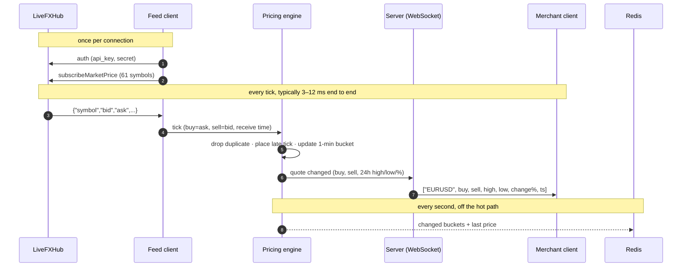

# Architecture


One Go service, two storage volumes. The **orange path** runs on every tick
and never touches storage; everything else is off the hot path.

## Data flow

| # | From → to | What moves | Notes |
|---|---|---|---|
| 1 | LiveFXHub → Feed client | Price ticks: `{"symbol","bid","ask",…}` | One authenticated session (`auth` → `subscribeMarketPrice`, 61 symbols). Reconnects with backoff. Upstream 24h fields are ignored. |
| 2 | Feed client → Pricing engine | Normalised ticks (symbol, buy=ask, sell=bid, time) | Passed through a bounded channel: back-pressure instead of dropping ticks. |
| 3 | Pricing engine → Server | Quotes that **changed** (buy, sell, 24h high, low, %) | Duplicates are dropped; late ticks update their own minute but never the latest price. |
| 4 | Server → Clients | Live quotes over WebSocket, JSON rows or binary, each frame < 10 KB | Only subscribed symbols. A slow client keeps just the newest quote per symbol. |
| 5 | Clients → Server, Server → Engine | WebSocket `auth`/`subscribe`; HTTPS requests | REST quotes and candles, and the snapshot sent on subscribe, are read from the engine. |
| 6 | Server ↔ Accounts & security | "Is this API key / session valid? Is KYC approved?" | Re-checked every 30 s. Revoking access closes that merchant's sockets at once (code 4003). |
| 7 | Engine → Flusher → Redis | Changed 1-minute buckets + last prices, every 1 s | Off the hot path. If Redis is down, changes are kept and retried. |
| 8 | Redis → Engine | Saved buckets | On start-up only, so quotes and candles survive restarts. |
| 9 | Accounts ↔ Redis, Secrets → Accounts | Accounts, KYC (encrypted), API-key hashes, audit; keys | Keys live on a separate volume, never in Redis. |

## One tick, end to end



## Components

| Component | Package | Responsibility |
|---|---|---|
| Feed client | `internal/feed` | Upstream session: auth, subscribe, ping/pong, 30 s silence timeout, reconnect with jittered backoff. Detects "session already active". Tolerant parser (`bid`/`ask` or `buy`/`sell`, any timestamp unit). |
| Pricing engine | `internal/engine` | Per-symbol state: duplicate filter, late-tick handling, rolling 24h window of 1-minute buckets (also served as candles). Changed quotes only. |
| Server | `internal/server` | WebSocket hub (auth, subscriptions, conflation, frame splitting, 10 msg/s limit), HTTP API, embedded UI pages, `/metrics`, `/healthz`. |
| Accounts & security | `internal/accounts`, `internal/security` | Registration, KYC submission and review, derived roles, API keys, WebSocket tickets, sessions, rate limits, audit log, field encryption. See [SECURITY.md](SECURITY.md). |
| Flusher | `internal/store` | Every second, writes changed buckets to Redis in one transaction; keeps and retries changes when Redis is unavailable. |
| Redis | volume `redis-data` | Price history (namespaced per upstream) and account data. Append-only log, fsync every second. |
| Secrets volume | volume `secrets-data` | Ed25519 session-signing key, AES-256 KYC key, HMAC pepper for API secrets. |

## Goroutines

| Goroutine | Does | Blocks on |
|---|---|---|
| feed reader | reads upstream frames, parses, sends ticks | network; bounded channel |
| feed pinger | upstream keep-alive | ticker |
| process | `Engine.Apply` then `Hub.Publish` | tick channel |
| flusher | persists changed buckets | ticker; Redis (5 s deadline) |
| hub revalidate | re-checks every connected merchant | ticker (30 s) |
| per client: writer / reader | sends frames / reads commands | that client's socket only |
| HTTP server | API and pages | — |

The engine has a single writer; readers (snapshots, candles, persistence)
take a short read lock. `Hub.Publish` never blocks on a client: it stages the
latest quote per symbol and wakes the writer once per batch, so a 61-symbol
update leaves as one frame.

## Rolling 24h window

```
per symbol: ring of 1440 one-minute buckets (slot = minute % 1440)
            each bucket = open, high, low, close, tick count

tick        update one bucket; high = max(cached high, current bucket)   O(1)
new minute  rescan 1440 slots once to drop the expired minute            O(1440), once a minute
late tick   update its own (older) bucket and the cached high/low        O(1)
24h change  (mid now − open of oldest bucket) / that open × 100
```

~73 KB per symbol, fixed regardless of tick rate. The clock is **event time**
(newest valid tick timestamp), so results are deterministic. Each time it
crosses a minute boundary, every symbol is re-evaluated, so a symbol that
stops ticking (FX at the weekend) still expires its old minutes.

## Storage layout (Redis)

```
pe:<upstream-host>:b:<SYMBOL>  hash  minute -> bucket (52 B binary)   price history, 48 h TTL
pe:<upstream-host>:last        hash  SYMBOL -> last buy/sell/ts        latest prices
acct:m:<id>                    JSON  account (password hash, encrypted KYC fields)
acct:email:<email>             -> id unique email index
acct:key:<pk_id>, acct:mkey:<id>     API key (HMAC of secret only)
acct:doc:<id>                  bytes encrypted KYC document
acct:audit                     list  newest-first audit events (capped at 1000)
```

Price history is namespaced by upstream host, so simulator data never mixes
with live data.

## Scaling out

- **More clients:** run several replicas behind a load balancer. All of them
  restore from the same Redis. Note that LiveFXHub allows one session per API
  key, so either give each replica its own key, or have one engine publish
  quotes (Redis Pub/Sub or NATS) to stateless WebSocket edge nodes.
- **More symbols:** shard symbols across engines (hash by symbol); each
  subscribes upstream only to its shard.
- **Shared session state:** move the refresh-token store, revocation list and
  WebSocket tickets from memory to Redis before running multiple replicas.
