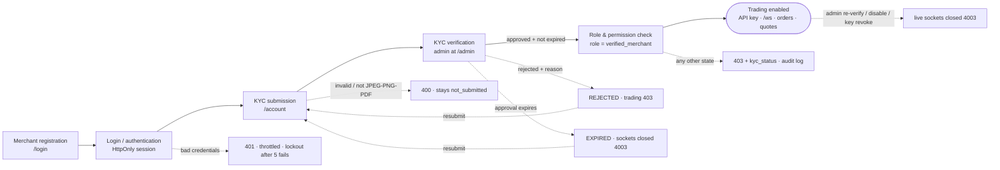

# Security — KYC & Authentication

> **Scenario:** *When implementing a new merchant account creation feature,
> what checks would you add to ensure only verified users can access
> trading functionality?*
>
> **Look for:** KYC validation, role-based access, secure storage of
> sensitive data.

**Short answer:** deny by default, and check on the server on every request.
A merchant reaches trading (orders, the price feed, market-data REST, API
keys) only if all of these hold at that moment:

1. They are authenticated: a valid session or API key that hasn't been
   revoked.
2. The account exists in the system of record and is not disabled.
3. The session was issued after the account's last security-relevant change
   (`TokenVersion`).
4. KYC is `approved` and not past its expiry.

The role (`admin` / `verified_merchant` / `unverified_merchant`) is
**derived** from KYC status on every request. It is never stored as a
free-standing flag and never taken from the client.

This is implemented end to end in this repo:

| Layer | Where |
|---|---|
| Account, KYC and API-key logic | [`internal/accounts`](../internal/accounts) |
| Security primitives | [`internal/security`](../internal/security): roles, KYC transitions, middleware, Argon2id, EdDSA tokens, AES-GCM, rate limits, log redaction |
| WebSocket access control | [`internal/server/hub.go`](../internal/server/hub.go): auth, session kicking, periodic re-checks |
| UI | `/login`, `/account`, `/admin`, `/` (quotes): [`internal/server/web`](../internal/server/web) |
| End-to-end proof | `TestMerchantLifecycle`, `TestKYCExpiryEndsAccess`, `TestTicketSingleUse`, `TestLoginLockout`, `TestTradingEndpointProtection` |

---

## Flow



**Try it in the UI:**
1. Register at `/login`.
2. On `/account`, look at the "Trading access" card: it says *Locked*. The
   test-order button answers **403 `kyc_status=not_submitted`**.
3. Submit KYC. The status becomes *pending*.
4. As admin, open `/admin` → **Review**. You see the decrypted details and a
   notice that the view is audit-logged. Click **Approve**.
5. As the merchant: generate an API key (the secret is shown once), open
   **Live quotes**, and place a test order.
6. As admin, click **Force re-verification**. The merchant's live quotes page
   is cut off immediately, and the API key stops working.

---

## A. KYC validation

| Concern | What the code does | Where |
|---|---|---|
| Identity & document checks | Server-side validation: legal name 2–120 chars; date of birth valid and **18+**; ISO-3166 alpha-2 country; document type from an allow-list; document number `^[A-Za-z0-9-]{4,30}$`. Uploads are capped at 2 MB, and the type is detected **from the bytes** (magic numbers), not the filename. Only JPEG, PNG and PDF are accepted, so an `.exe` renamed to `.png` is refused (tested). | `KYCForm.validate`, `SniffDoc` |
| Status lifecycle | `not_submitted → pending` (merchant) · `pending → approved / rejected` (admin) · `rejected → pending` and `expired → pending` (merchant resubmits) · `approved → expired` (system) · `approved → pending` (admin forces re-review). Any other transition is refused. | `security.Transition` |
| Who may decide | Only an admin approves or rejects, and never on their own account. Approval requires a validity period (1–3650 days); rejection requires a reason, which is shown to the merchant. Admins cannot submit KYC or trade (separation of duties). | `Transition`, `Service.Review`, `CanTrade` |
| Preventing unverified trading | Trading actions (`POST /api/v1/orders`, `POST /api/v1/apikey`, WebSocket API-key auth) require `Merchant.CanTrade(now)`. Market data (`/api/v1/quotes`, `/api/v1/candles`, `POST /api/v1/ws-ticket`) requires `CanViewMarket`, which means verified merchants, or admins in read-only mode. Unverified merchants get 403 on all of them. The UI shows the order button to everyone **on purpose**, so the 403 is visibly a server decision. | `security/middleware.go`, `accounts/http.go` |
| Expiry | `EffectiveKYC(now)` treats an approval past `ExpiresAt` as `expired` immediately, without waiting for a cron job. The hub re-checks each connected merchant every 30 s, so a socket opened before expiry is closed after it. | `kyc.go`, `Hub.Revalidate` |
| Status changes take effect now | Reject, re-verify, disable and key rotation all call `Kick(merchantID)`: every open socket for that merchant gets close code **4003**. Each transition bumps `TokenVersion`, so existing session tokens fail and must refresh, which re-derives the role. | `Service.Review/SetDisabled/IssueAPIKey`, `Hub.Kick` |
| Audit | `register`, `login`, `login_failed`, `login_throttled`, `kyc_submitted`, `kyc_approve/reject/reverify`, `pii_viewed`, `document_viewed`, `apikey_issued/revoked`, `apikey_auth_failed`, `account_disabled/enabled`, `order_filled` and `refresh_reuse_detected` are all logged, and shown on `/admin`. | `Store.Audit` |

## B. Role-based access control

**Roles are derived, never assigned:**

```go
func (m *Merchant) Role(now time.Time) Role {
    switch {
    case m.IsAdmin:                          return RoleAdmin
    case m.EffectiveKYC(now) == KYCApproved: return RoleVerifiedMerchant
    default:                                 return RoleUnverifiedMerchant
    }
}
func (m *Merchant) CanTrade(now time.Time) bool {      // orders, API keys
    return !m.Disabled && !m.IsAdmin && m.Role(now) == RoleVerifiedMerchant
}
func (m *Merchant) CanViewMarket(now time.Time) bool { // quotes, candles, price feed (read-only)
    return !m.Disabled && (m.IsAdmin || m.CanTrade(now))
}
```

Admins get **read-only** market data for oversight. They cannot place
orders or hold API keys, which keeps separation of duties: the person who
approves KYC can't trade.

**Middleware chains** (stdlib `net/http`; the order matters):

```go
trading := Chain(h, SameOrigin, Authenticate(tokens, directory), RateLimit(perMerchant), RequireTrading)
admin   := Chain(h, SameOrigin, Authenticate(tokens, directory), RateLimit(perMerchant), RequireRole(RoleAdmin))
market  := MarketAccess(h)  // session OR X-API-Key/X-API-Secret, then RateLimit + RequireMarketView
orders  := TradingAccess(h) // same authentication, then RateLimit + RequireTrading
```

`Authenticate` verifies the token, then **reloads the merchant from Redis on
every request**. A disabled account, or a token older than `TokenVersion`,
gets 401.

**Permission matrix** (enforced server-side; UI visibility is cosmetic):

| Endpoint | Anonymous | Unverified | Verified | Admin |
|---|---|---|---|---|
| `POST /api/v1/auth/register`, `login`, `refresh`, `logout` | ✅ | ✅ | ✅ | ✅ |
| `GET /api/v1/me`, `POST /api/v1/kyc` | 401 | ✅ | ✅ | ✅ (KYC: 400) |
| `POST /api/v1/apikey`, `POST /api/v1/orders` | 401 | **403** | ✅ | 403 (no trading) |
| `GET /api/v1/quotes`, `GET /api/v1/candles`, `POST /api/v1/ws-ticket` (live quotes page) | 401 | **403** | ✅ | ✅ read-only |
| `/ws` `auth` with API key | 4001 | **4003** | ✅ | n/a |
| `/api/v1/admin/*` | 401 | 403 | 403 | ✅ |

**Privilege escalation is closed off:**
- Request bodies are never used for authorization: a body containing
  `{"role":"admin","kyc_status":"approved"}` is ignored (tested).
- JSON decoders reject unknown fields.
- The JWT `role` claim is informational only.
- Object-level rules: merchants act only on their own record (the ID comes
  from the session, not the URL), and only admin routes take an `{id}`.

## C. Secure storage

| Data | Protection |
|---|---|
| Passwords | **Argon2id** (m=64 MiB, t=3, p=2, 16-byte salt) in PHC format. Constant-time compare. Length is limited to 12–128 characters to bound hashing cost. Unknown emails get a dummy hash, so response timing doesn't reveal which accounts exist. |
| KYC PII: legal name, date of birth, document number | **AES-256-GCM per field**, with the account ID and field name as associated data. A ciphertext copied to another record or column fails to decrypt. A key-ID byte supports rotation. Tests check the raw Redis contents contain none of these values in plaintext. |
| Document scans | AES-256-GCM, bound to the account, in a separate Redis key. Only admins can fetch them. Every view is audit-logged. Served with `Content-Security-Policy: sandbox`, `nosniff` and `no-store`. |
| API secrets | 256-bit random `sk_…`, **shown once**. Only `HMAC-SHA256(pepper, secret)` is stored, compared in constant time. A keyed fast hash is correct for high-entropy secrets; Argon2 would only add latency to every WebSocket login. The pepper is outside Redis, so a database dump alone can't be used to check guesses offline. |
| Key material | The signing key (Ed25519), the KYC encryption key and the API-key pepper live in `SECRETS_DIR`: a **separate Docker volume**, not Redis. Files are mode 0600 and the directory is owned by the non-root user. In production this would be a KMS or secret manager. |
| Session & refresh tokens | Access token: EdDSA JWT, 15 minutes, in an **HttpOnly, SameSite=Strict** cookie (Secure behind HTTPS), so page JS can never read it. Refresh token: opaque 256-bit, cookie scoped to `/api/v1/auth`, **rotated on each use**, stored as SHA-256. Reusing one revokes the whole token family. |
| Browser WebSocket access | The secret never reaches page JS. The session is exchanged for a **single-use, 30-second ticket**. |
| Logs | `RedactingHandler` blanks any attribute whose name looks sensitive (`password`, `secret`, `token`, `api_key`, `passport`, `document`, …), including nested groups. `Config.String()` masks the upstream keys. The API never serialises the `Account` struct; responses are explicit DTOs without hashes or ciphertext. |
| Browser hardening | Strict CSP: `script-src 'self'`, no inline scripts or styles (tested), `frame-ancestors 'none'`. Also `nosniff`, `no-referrer`, and `SameOrigin` checks on state-changing requests. All user-supplied text is HTML-escaped before rendering. |

## D. Authentication

- **Login:** a per-IP limit plus a per-account limit, with a **15-minute
  lockout after 5 failures**. The lockout is keyed by account, so rotating
  IPs doesn't help (tested). Errors are generic (`invalid email or
  password`). Registration is limited to 5 per IP per minute.
- **Expiry, refresh, revocation:**
  - Access tokens expire after 15 minutes.
  - Refresh tokens are rotated on use, with reuse detection.
  - Logout revokes the access token's `jti` and all refresh tokens.
  - Disabling an account revokes its refresh tokens and closes its sockets.
  - Any KYC or role change bumps `TokenVersion`, which invalidates
    outstanding access tokens.
- **Rate limiting:** a token bucket per merchant, or per IP when
  anonymous, on every API route (429 + `Retry-After`). WebSocket clients are
  limited to 10 commands/s, plus a global limit on auth attempts.
- **Protected APIs:** every route except `/healthz`, `/metrics` and the
  static pages sits behind `Authenticate`, `MarketAccess` or the WS auth
  handshake. Unauthenticated sockets are closed after 10 s.

## Merchant account creation checklist

1. Validate input; normalise the email (lower-case, trimmed) and keep a
   uniqueness index (`SETNX`).
2. Hash the password with Argon2id and enforce length limits.
3. Create the account with `kyc=not_submitted`, so the role is
   **unverified_merchant**: it can log in but can't trade.
4. Throttle registration per IP.
5. On KYC submission: validate, encrypt the PII fields and the document,
   set status `pending`, audit.
6. An admin decides through the `Transition` rules (no self-review; expiry
   required; reason required to reject), and it's audited.
7. Every trading route enforces `Authenticate → RateLimit → RequireTrading`,
   default deny. The same predicate guards API keys, WebSocket tickets and
   WebSocket auth.
8. Access is re-checked continuously: `Kick` on each change, a 30 s
   re-check for live sockets, and `EffectiveKYC` for expiry.
9. Audit-log every decision and every denied attempt.

## Known limitations

These are deliberate scope cuts for an assessment, not oversights.

- **No email verification.** A production system would confirm the email
  before KYC, and would answer registration identically whether or not the
  email exists (registration here returns 409 for a taken email, mitigated by
  per-IP throttling).
- **In-memory session state.** The refresh-token store, access-token
  revocation list and WebSocket tickets are kept in process memory. A
  restart logs users out, which is safe but a nuisance, and multi-replica
  deployments would need these in Redis.
- **No external identity check.** Document checks are format and integrity
  only; a real system would call a KYC provider (identity match, sanctions /
  PEP screening) and accept its webhook with HMAC verification.
- **Simulated orders.** `/api/v1/orders` fills at the live price but there
  is no order book; it exists to demonstrate server-side enforcement.
- **No account deletion or retention policy** (GDPR erasure, document
  retention periods).
